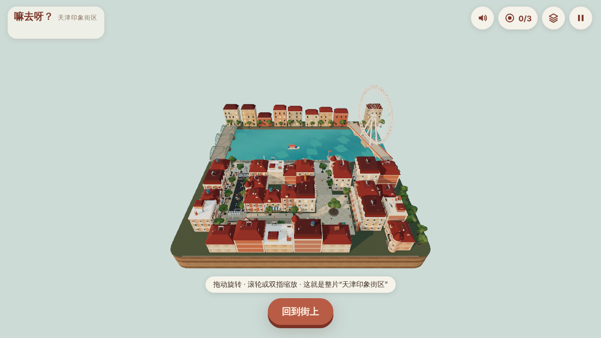

# 嘛去呀？——天津散步
**A Little Walk in Tianjin**

▶ 在线试玩：https://yuangbai86.github.io/tianjin-walk/

在一片温暖的“天津印象街区”里第一人称散步：看海河、小洋楼和天津之眼，跟街坊聊两句，吃套煎饼果子，摸摸广场上的小猫。
地图是艺术化浓缩的，并非真实地理比例。整片街区做成一块悬浮在薄荷绿背景上的**微缩模型地台**（圆角土层底座、海河水体剖面），按 **V** 可随时切到全景俯瞰、拖动旋转。



## 运行

```bash
npm install
npm run dev        # 开发：http://localhost:5173
npm run build      # 构建到 dist/
npm run preview    # 预览构建结果：http://localhost:4173
```

需要 Node 20.19+（已用 Node 22 验证）。`dist/` 是纯静态文件（`base: './'`），可以放到任意静态托管上。

## 玩法

| 电脑 | 手机 |
| --- | --- |
| WASD / 方向键 走动，Shift 走快点 | 屏幕左侧按住拖动：走动 |
| 鼠标环顾（点击“开始散步”后锁定鼠标） | 屏幕右侧拖动：环顾 |
| E 互动 / 对话中显示整句、继续 | 右下角互动按钮 |
| 1 2 3 选择对话选项，B 印章本，V 全景，Esc 结束对话或暂停 | 右上角按钮：声音、印章、全景、暂停 |

**环线**：小洋楼街（起点）→ 街角早点摊 → 海河步道（钓鱼大爷、长椅、小拱桥）→ 天津之眼观景点 → 望眼道 → 口袋广场（快板、小猫、鸽子）→ 槐荫里 → 回到起点。

**印章**
- 津门早点：在煎饼摊买一套煎饼果子（油条或馃箅儿，不涉及真实支付）
- 海河散步：走过小拱桥，并在观景点用望远镜看天津之眼（会触发亮灯）
- 天津熟人：和 5 位街坊（煎饼摊主、钓鱼大爷、指路姐姐、快板大爷、长椅阿姨）都聊上两句

集齐三枚后播放收尾：镜头升到全景，天津之眼亮灯、海河上放烟花，结尾卡片显示“行啊，您了这也算天津熟人了！”并总结这趟散步，可以看纪念明信片（实时渲染海河与天津之眼，可下载 PNG）、接着溜达或重新开始。印章本里可以再看一遍结尾。
进度与设置保存在 localStorage，暂停菜单里可以“重新开始”。

## 视觉与声音

- **天津元素（参考公开资料）**：五大道小洋楼的红砖清水墙与红青砖分层、拱形门洞与拱形大窗、意式拱券门廊、英式半木构山墙、凸窗、铁艺阳台、砖垛铁栅院墙；民园广场式两层红砖拱廊；解放桥式三孔钢桁架开启桥；永乐桥上的天津之眼（48 个座舱）；绿豆面煎饼与竹刮子。
- **微缩模型密度**：电线杆与下垂电线、红灯笼串、竖招牌、太阳能热水器、水箱、鸽子笼、晾衣绳、楼顶菜园、空调外机、落水管、门牌、盲道、井盖、斑马线与“慢行”路面字、施工锥桶、观光马车、楼顶巨型麻花与霓虹招牌。
- **渲染（three.js）**：程序化贴图（砖、灰浆、瓦、方砖、柏油、石材、木纹、土层）以世界坐标三平面投影贴到合并后的几何上；天空生成的 PMREM 环境光；高画质下 MSAA + GTAO 环境光遮蔽（EffectComposer → RenderPass → GTAOPass → OutputPass）；“自动”画质在帧率过低时降到“中”。
- **背景音乐**：`src/core/Music.js` 用 WebAudio 实时合成的原创曲子（D 宫五声音阶，古筝感拨弦旋律 + 铺底 + 低音 + 木鱼，乐句随机组合），设置中可单独开关和调音量；对话时自动压低，快板表演时让位。另有鸟叫、马的响鼻等环境音。

## 代码结构

```
src/
  main.js              状态机（加载/开始/散步/对话/暂停）、指针锁定、互动分发、印章、明信片
  core/                材质与程序化贴图、2D 碰撞、输入（键鼠+触摸）、WebAudio 音效与背景音乐、存档
  world/               地图与悬浮地台（World.js）、小洋楼生成器（buildings.js）、街道道具（props.js）、
                       生活杂物（clutter.js）、海河水面、天津之眼、蒸汽粒子、静态网格合并
  npc/                 卡通人物生成与动画（Character.js）、NPC 行为/小猫/鸽子（NPCs.js）
  systems/             互动目标选择、对话面板、明信片合成
  data/                对白（dialogues.js）、方言释义（glossary.js）、印章（stamps.js）
  ui/UI.js             HUD、提示、通知、弹窗栈、设置
```

- **改文案**：只需编辑 `src/data/dialogues.js`。`{词}` 会显示下划线和普通话释义（释义在 `glossary.js`）；`entry(s)` 根据拜访次数和进度决定开场白，所以再次拜访时对白会变。
- **换模型**：NPC 外观集中在 `src/npc/NPCs.js` 的 `DEFS`；建筑由 `world/buildings.js` 的 `yanglou()` 生成，布局在 `World.buildBuildings()`。要换成 glTF 模型，只要在相同位置加载模型、替换对应的 group 即可，碰撞盒与互动点不受影响。
- **加声音文件**：目前所有声音（河水、风、脚步、煎饼滋滋声、快板、猫叫、车铃、印章）都用 WebAudio 实时合成，项目里没有任何音频文件。真人方言配音可以在 `Dialogue.showPage()` 里按节点 id 播放。

## 技术取舍

- Three.js（WebGLRenderer，WebGL 兼容路径）+ Vite；界面用原生 HTML/CSS。
- **没有用 Rapier**：街区地面平坦，只有小拱桥有坡度，所以用“圆 vs 轴对齐盒”的 2D 碰撞，再加一个地面高度函数，更轻量；移动还做了子步，低帧率下也不会穿过细栏杆。建筑碰撞盒同时用于判断对话目标是否被墙挡住。
- 静态模型按“材质 × 空间格子”合并，绘制调用少；阴影相机跟随玩家并按像素对齐。
- 画质分自动/高/中/低三档：像素比上限分别为 2 / 1.5 / 1，阴影贴图 2048 / 1024 / 关闭。
- 加载进度对应真实的构建步骤（地面、建筑、绿化……合并、着色器预编译）；JS 下载阶段显示不定进度动画。

## 部署

推送到 `main` 分支后，`.github/workflows/pages.yml` 会自动构建并发布到 GitHub Pages。

## 参考与许可

视觉上借鉴了 three.js 示例 “Littlest Tokyo”（模型作者 Glen Fox，CC-BY）那种悬浮微缩街区的风格，但没有使用该模型或其任何素材，场景全部是程序生成的天津内容。
形式上参考了 Bruno Simon 的 [folio-2025](https://github.com/brunosimon/folio-2025)（MIT）：整页可探索的 3D 世界、玩具质感、场景内路牌引导、及时的反馈。
本项目**没有复制它的代码或素材**，模型、地图、对白、声音均为原创或程序生成，所以不需要附带它的许可文件。依赖 three.js（MIT）与 Vite（MIT）。
场景里的店名（“倍儿亮理发”“嘛都有便利店”等）为虚构。
